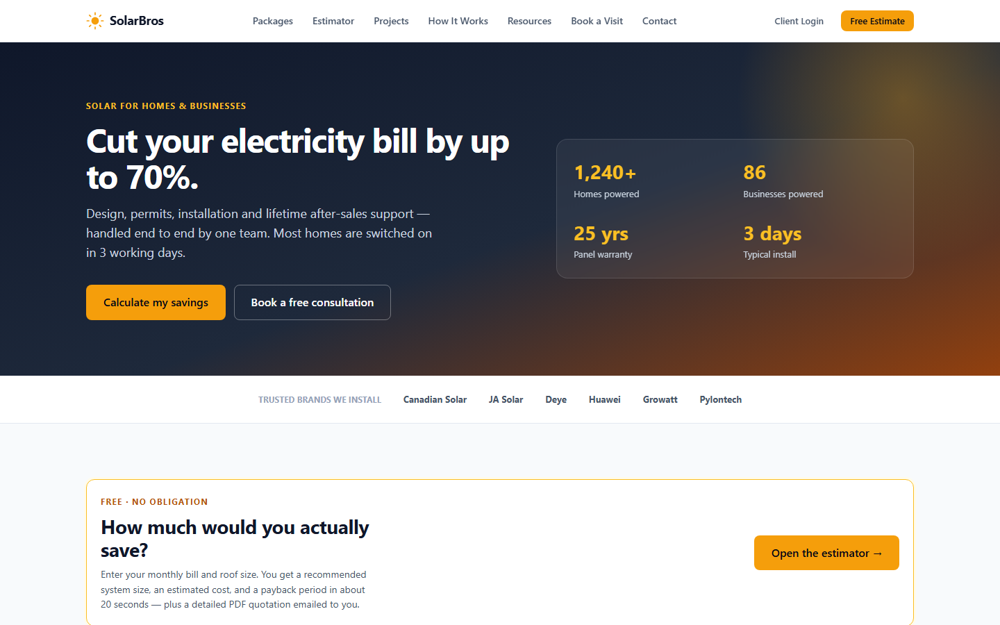
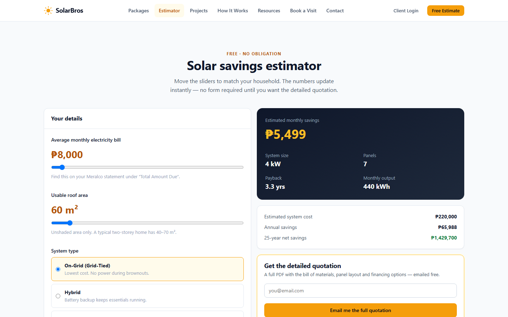
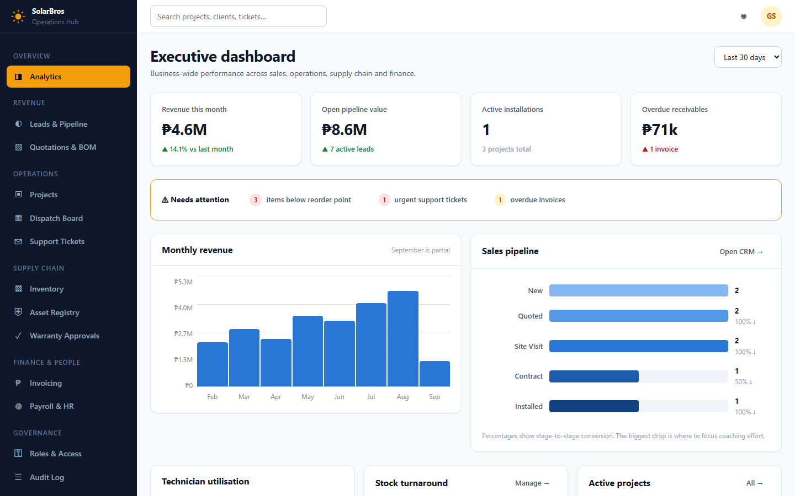
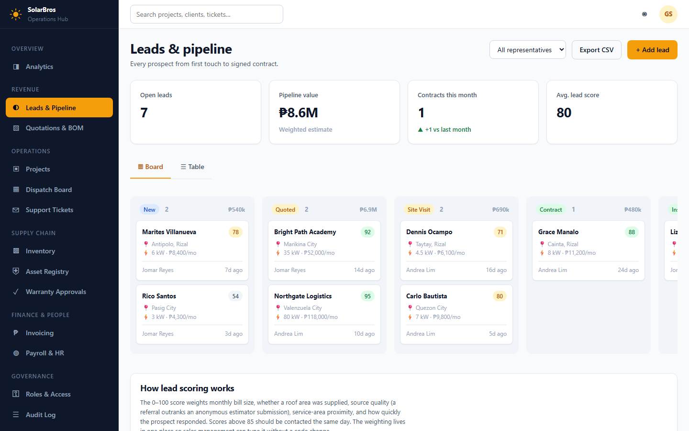
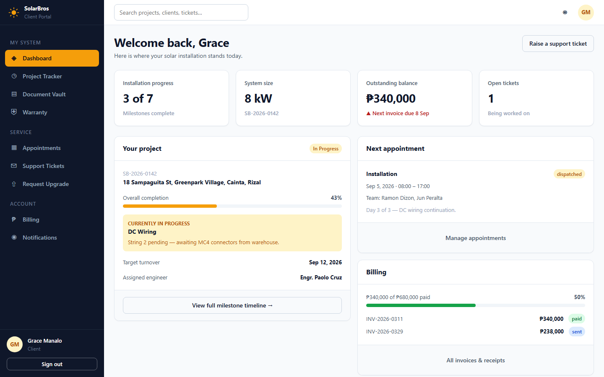
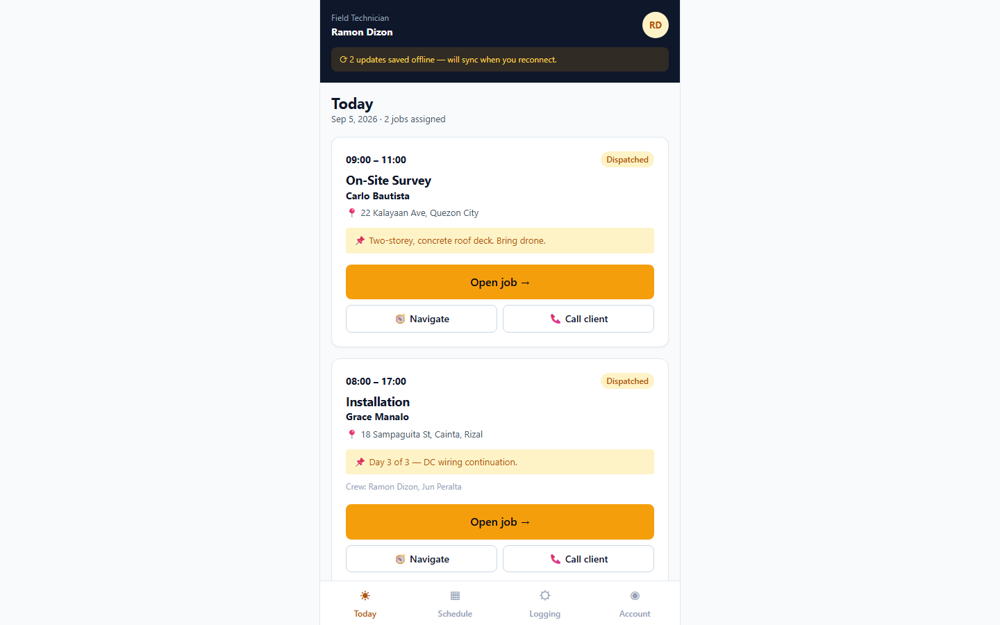

<div align="center">

# ☀️ SolarBros

### Integrated Enterprise Web Platform for a Solar Energy Business

A single system covering the full customer lifecycle — from first website visit,
through sales and installation, to lifetime after-sales support.

[](https://github.com/G1AN5/solarbros/actions/workflows/ci.yml)


</div>

---

## 1. Overview

Solar installation businesses run on fragmented tools: leads in a spreadsheet,
schedules in a group chat, inventory in a notebook, and customers phoning the
office to ask "what's happening with my installation?"

**SolarBros replaces all of that with one platform.** It is built as four
purpose-specific portals sharing a single database, so a technician's update on a
rooftop instantly becomes the progress bar the customer sees at home and the
status the accountant bills against.

| Portal                            | Route     | Users           | Purpose                                                     |
| --------------------------------- | --------- | --------------- | ----------------------------------------------------------- |
| 🌐 **Public Web Platform**        | `/`       | Prospects       | Lead generation — estimator, packages, self-service booking |
| 👤 **Client Self-Service Portal** | `/portal` | Customers       | Live project tracking, documents, billing, support          |
| 🏢 **Enterprise Operations Hub**  | `/admin`  | Staff (5 roles) | CRM, projects, dispatch, inventory, finance, governance     |
| 🔧 **Field Technician Portal**    | `/field`  | Technicians     | Mobile job execution, milestone updates, asset logging      |

---

## 2. Screenshots

**Public landing page** — lead-generation site with trust signals and estimator
entry points



**Interactive solar estimator** — live sizing and savings calculation, the top of
the sales funnel



**Executive analytics dashboard** — revenue, pipeline conversion, technician
utilisation and stock health



**Sales CRM pipeline** — Kanban board with lead scoring, prospect to signed
contract



**Client self-service portal** — installation progress, outstanding balance and
next appointment at a glance



**Field technician portal** — mobile-first job list with offline-tolerant data
capture



---

## 3. Core modules

**Customer acquisition**

- Interactive solar estimator — computes system size, cost, payback period and
  25-year savings from a monthly bill and roof area
- Self-service appointment booking for consultations and site surveys
- Package comparison with an on-grid / hybrid / off-grid decision table

**Sales and operations**

- CRM pipeline with lead scoring and stage-to-stage conversion tracking
- Automated Bill of Materials generation with real-time stock reservation
- Project tracking across seven installation milestones
- Dispatch board assigning crews to surveys, installations and repairs

**Supply chain and after-sales**

- Inventory using a three-number model: on-hand, reserved, available
- Serialised asset registry mapping every panel and inverter to its warranty
- Support ticketing that escalates into scheduled service visits
- Warranty registration and property-transfer approvals

**Finance and governance**

- Staged milestone invoicing with receivables ageing
- Role-based access control across seven distinct roles
- Immutable audit log of all privileged actions

---

## 4. Architecture

### The central design decision

The installation milestone timeline is **one shared component rendered by three
different screens** — the customer's tracker, the admin project view, and the
technician's updater.

```
   Technician taps "DC Wiring complete" on site
                     |
                     v
        +------------+------------+
        |                         |
        v                         v
  Customer's progress      Operations dashboard
  bar advances             + triggers the milestone
  (client portal)          invoice (finance)
```

Because all three render the same records, the customer's view **cannot**
disagree with what actually happened on the roof. Progress is reported by the
person who did the work, not by an office keying in what they were told.

### Cross-portal data flow

| Event               | Origin         | Destination                           |
| ------------------- | -------------- | ------------------------------------- |
| Estimator submitted | Public site    | CRM lead                              |
| Booking requested   | Public site    | Dispatch board                        |
| Contract signed     | CRM            | Project + stock reservation + invoice |
| Crew assigned       | Dispatch board | Technician's job list                 |
| Milestone completed | Field portal   | Client tracker + operations + finance |
| Serials scanned     | Field portal   | Asset registry + client warranty page |
| Ticket raised       | Client portal  | Support queue, then repair visit      |

> **The application includes a live architecture map at `/site-map`** which
> renders every route, every data flow and the role-permission matrix —
> generated from the source code, so it cannot fall out of date.

---

## 5. Technology stack

| Layer        | Technology                     | Rationale                                           |
| ------------ | ------------------------------ | --------------------------------------------------- |
| Build        | Vite 8                         | Fast HMR, first-class TypeScript                    |
| UI           | React 19 + TypeScript (strict) | Type safety across roughly 50 screens               |
| Routing      | React Router 7                 | Nested layouts, per-portal route guards             |
| Server state | TanStack Query                 | Caching and refetch for live operational data       |
| Forms        | React Hook Form + Zod          | Schema-validated input                              |
| Styling      | Token-based CSS                | No framework — one file re-skins the whole app      |
| Charts       | Custom SVG and CSS             | Zero dependencies, accessibility-validated palette  |
| Backend      | Supabase (PostgreSQL)          | Managed Postgres, Auth, Storage, Row Level Security |
| Testing      | Vitest + Playwright            | Unit and end-to-end                                 |
| CI           | GitHub Actions                 | Format, lint, typecheck, test and build on every PR |

### Engineering practices

- **Strict TypeScript** with a hand-written domain model (`src/types/domain.ts`)
  mirroring the planned database schema
- **Design tokens** — no component hard-codes a colour, so rebranding is a
  single-file change
- **Conventional Commits** enforced by a commit-message hook
- **Pre-commit gate** running lint, formatting and type-checking on staged files
- **Accessibility-validated chart palette** — colours checked programmatically
  for colour-blind separation and contrast against the actual render surface

---

## 6. Running the project

**Requirements:** Node.js 22 or newer

```bash
git clone https://github.com/G1AN5/solarbros.git
cd solarbros
npm install
npm run dev
```

Open <http://localhost:5173>. **No backend credentials are required** — the
interface runs on mock data while the database schema is being finalised.

### Exploring all four portals

Authentication is mocked during the UI phase. A **⚙ role switcher appears at the
bottom-right of every screen** (development builds only) — use it to sign in as
any of the seven roles and jump directly into that portal.

| Start here  | To see                                           |
| ----------- | ------------------------------------------------ |
| `/site-map` | The complete architecture map                    |
| `/`         | Public marketing site                            |
| `/portal`   | Client portal _(switch role to Client)_          |
| `/admin`    | Operations hub _(switch role to Administrator)_  |
| `/field`    | Field portal _(switch role to Field Technician)_ |

### Available scripts

| Command             | Purpose                                   |
| ------------------- | ----------------------------------------- |
| `npm run dev`       | Development server with hot reload        |
| `npm run build`     | Type-check and produce a production build |
| `npm run test`      | Unit tests                                |
| `npm run lint`      | ESLint                                    |
| `npm run typecheck` | TypeScript, no emitted output             |
| `npm run format`    | Format with Prettier                      |
| `npm run db:types`  | Regenerate types from the Supabase schema |

---

## 7. Project status

| Area                                | Status                           |
| ----------------------------------- | -------------------------------- |
| UI — all four portals, ~50 screens  | ✅ Complete and navigable        |
| Routing, layouts, role guards       | ✅ Complete                      |
| Design system and component library | ✅ Complete                      |
| Domain model                        | ✅ Defined                       |
| Supabase project                    | ✅ Provisioned and CLI-linked    |
| CI pipeline                         | ✅ Configured                    |
| Database schema and RLS policies    | 🔜 In progress                   |
| Live data integration               | 🔜 Next phase                    |
| Payments, payroll, offline sync     | 📋 Scoped, deliberately deferred |

### Security note

All role checks currently in the codebase govern **navigation only** — which menu
items and routes render. They are explicitly _not_ a security boundary, since
client-side JavaScript can be modified by any user.

Before any real data is stored, every table will carry **Row Level Security
policies in PostgreSQL**, enforced by the database itself. The permission matrix
rendered at `/admin/governance` serves as the specification those policies must
implement.

---

## 8. Documentation

| Document                                             | Contents                                                           |
| ---------------------------------------------------- | ------------------------------------------------------------------ |
| [`docs/UI-ARCHITECTURE.md`](docs/UI-ARCHITECTURE.md) | Folder structure, data flows, requirement traceability, RBAC model |
| `/site-map` (in-app)                                 | Live, self-generating architecture map                             |

Every source file carries a header comment explaining its responsibility and how
it connects to the rest of the system.

---

<div align="center">
<sub>Built with React and Supabase.</sub>
</div>
